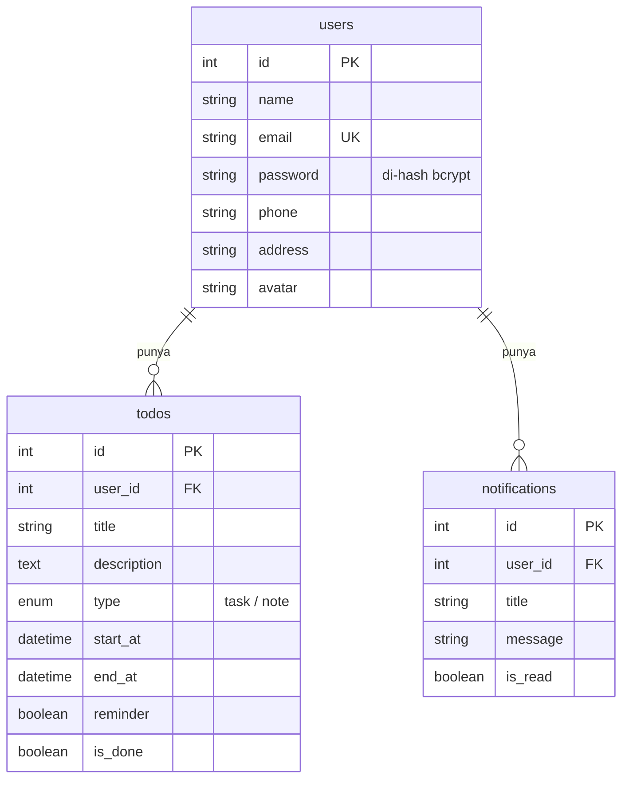

# **👋 Hollaaa!**

Repo ini adalah **API siap pakai** supaya kamu bisa fokus belajar **menerapkan login di tampilan Flutter**, tanpa pusing bikin backend dari nol.

API yang terdapat pada project ini adalah:

| API | Deskripsi |
|---|---|
| **Auth** | Daftar & login dengan email + password |
| **Home** | Melihat todo yang dikelompokkan per tanggal |
| **Inbox** | Melihat Notifikasi |
| **Profil** | Melihat dan mengubah data diri |

> 💡 Kamu **tidak perlu mengubah kode API ini**. Cukup jalankan, lalu panggil dari aplikasi Flutter-mu.
---

<br>
<br>

## **Persiapan**

Pastikan sudah terpasang:

- [Node.js](https://nodejs.org) versi 18 atau lebih baru
- [MySQL](https://dev.mysql.com/downloads/) (atau XAMPP / Laragon / atau semacam nya)

---

<br>

## **Cara Menjalankan API ini**

Ikuti langkah ini secara berurutan

### **1. Install/update dependency**

```bash
npm install
```
---

### **2. Buat file `.env`**

```bash
cp .env.example .env
```

Di terminal (CMD): `copy .env.example .env`


Lalu buka `.env` dan sesuaikan dengan MySQL-mu:

```env
PORT=3000

DB_HOST=localhost
DB_PORT=3306
DB_USER=root
DB_PASSWORD=
DB_NAME=todo

JWT_SECRET=isi dengan jwt secret
JWT_EXPIRES_IN=1d
```

> ⚠️ `JWT_SECRET` **wajib diisi**, kalau kosong server tidak bisa digunakan.

---

### **3. Jalankan migration**

```bash
npm run migrate
```

Kalau berhasil, kamu akan melihat output seperti ini di terminal:

```
✔  migrated: 001_create_users_table.js
✔  migrated: 002_create_todos_table.js
✔  migrated: 003_create_notifications_table.js
```

---

### **4. Isi data contoh**

```bash
npm run seed
```

Akun demo yang dibuat:

| Email | Password |
|---|---|
| `email@gmail.com` | `password123` |

---

### **5. jalankan project / server**

```bash
npm run dev
```

Buka `http://localhost:3000`. Kalau muncul pesan *"todo API berjalan"*, berarti berhasil! 🎉
Dokumentasi interaktifnya ada di `http://localhost:3000/api-docs` (lihat [Dokumentasi Swagger](#-dokumentasi-swagger)).

---

<br>

## **Perintah lain**

| Perintah | Fungsi |
|---|---|
| `npm start` | Menjalankan server (mode biasa) |
| `npm run dev` | Menjalankan server dan otomatis restart saat kode berubah |
| `npm run migrate` | Membuat tabel yang belum ada |
| `npm run migrate:rollback` | Mundur 1 langkah migration |
| `npm run migrate:fresh` | Hapus semua tabel lalu buat ulang (⚠️ data hilang) |
| `npm run seed` | Mengisi data contoh |

<br>


## **Dokumentasi Swagger**

Setelah server berhasil dijalankan, buka di browser:

👉 **http://localhost:3000/api-docs**

Di sini kamu bisa melihat semua endpoint dan **mencobanya langsung** tanpa Postman:

1. Buka **Auth → `POST /auth/login`** → klik **Try it out** → **Execute**
   (pakai akun demo `email@gmail.com` / `password123`)
2. Salin nilai `token` dari response
3. Klik tombol **Authorize** 🔓 di kanan atas → tempel token (**tanpa** kata `Bearer`) → **Authorize**
4. Sekarang semua endpoint bergembok 🔒 bisa dicoba!

> Token tetap tersimpan walau halaman di-refresh. File spec mentahnya ada di `http://localhost:3000/api-docs.json`, bisa di-import ke Postman.

---

<br>

## **Daftar Endpoint**

Base URL: `http://localhost:3000/api`

🔓 = tanpa token <br>
🔒 = wajib token Bearer

### **Auth**

| Method | URL | Akses | Fungsi |
|---|---|:---:|---|
| POST | `/auth/register` | 🔓 | Daftar akun baru |
| POST | `/auth/login` | 🔓 | Login, mendapatkan token |

<br>

### **Todo**

| Method | URL | Akses | Fungsi |
|---|---|:---:|---|
| GET | `/todos/grouped` | 🔒 | Todo dikelompokkan per tanggal (halaman **Home**) |
| GET | `/todos` | 🔒 | Semua todo dalam satu list (halaman **Inbox**) |
| GET | `/todos/:id` | 🔒 | Detail satu todo |
| POST | `/todos` | 🔒 | Tambah todo (tombol **+**) |
| PUT | `/todos/:id` | 🔒 | Ubah todo |
| PATCH | `/todos/:id/done` | 🔒 | Tandai selesai / belum selesai |
| DELETE | `/todos/:id` | 🔒 | Hapus todo |

Query yang bisa dipakai:

| Query | Berlaku di | Contoh | Fungsi |
|---|---|---|---|
| `search` | `/todos`, `/todos/grouped` | `?search=design` | Cari berdasarkan judul / deskripsi (kolom Search) |
| `type` | `/todos` | `?type=note` | Filter `task` atau `note` |
| `is_done` | `/todos` | `?is_done=0` | Filter belum selesai (`0`) / selesai (`1`) |

<br>

### **Notifikasi**

| Method | URL | Akses | Fungsi |
|---|---|:---:|---|
| GET | `/notifications` | 🔒 | Daftar notifikasi + jumlah yang belum dibaca |
| PATCH | `/notifications/:id/read` | 🔒 | Tandai 1 notifikasi sudah dibaca |
| PATCH | `/notifications/read-all` | 🔒 | Tandai semua sudah dibaca |

<br>

### **Profil**

| Method | URL | Akses | Fungsi |
|---|---|:---:|---|
| GET | `/profile` | 🔒 | Lihat data profil |
| PUT | `/profile` | 🔒 | Ubah nama, phone, address, avatar |

---

## **Kode Status HTTP**

| Kode | Artinya | Contoh |
|:---:|---|---|
| `200` | Berhasil | Login berhasil, data berhasil diambil |
| `201` | Berhasil dibuat | Registrasi / tambah todo |
| `401` | Belum login / token salah | Token tidak dikirim, salah, atau kedaluwarsa. Atau email/password salah |
| `404` | Data tidak ditemukan | Todo dengan id tersebut tidak ada (atau milik user lain) |
| `409` | Konflik | Email sudah terdaftar |
| `422` | Data yang dikirim tidak valid | Password kurang dari 8 karakter, title kosong, format tanggal salah |
| `500` | Error di server | Biasanya masalah koneksi database |

---

<br>

## **Struktur Database**



> 🔒 Password **tidak pernah** disimpan sebagai teks biasa, tapi di-hash dengan `bcrypt`.
---

<br>

## **Struktur Folder**

```
todo-api/
├── src/
│   ├── app.js                  # Konfigurasi Express
│   ├── server.js               # Kode untuk menjalankan server
│   ├── config/
│   │   └── db.js               # Koneksi MySQL
│   ├── middleware/
│   │   ├── auth.js             # Cek token JWT (Bearer)
│   │   └── errorHandler.js     # Penanganan error
│   ├── routes/
│   │   └── index.js            # Daftar semua endpoint
│   ├── controllers/            # Controller
│   │   ├── authController.js
│   │   ├── todoController.js
│   │   ├── notificationController.js
│   │   └── profileController.js
│   ├── docs/
│   │   └── openapi.js          # Dokumentasi Swagger
│   ├── utils/
│   │   └── helpers.js
│   └── database/
│       ├── migrate.js          # Menjalankan migration
│       ├── seed.js             # Data contoha
│       └── migrations/         # Skema tabel
├── .env.example
└── package.json
```
